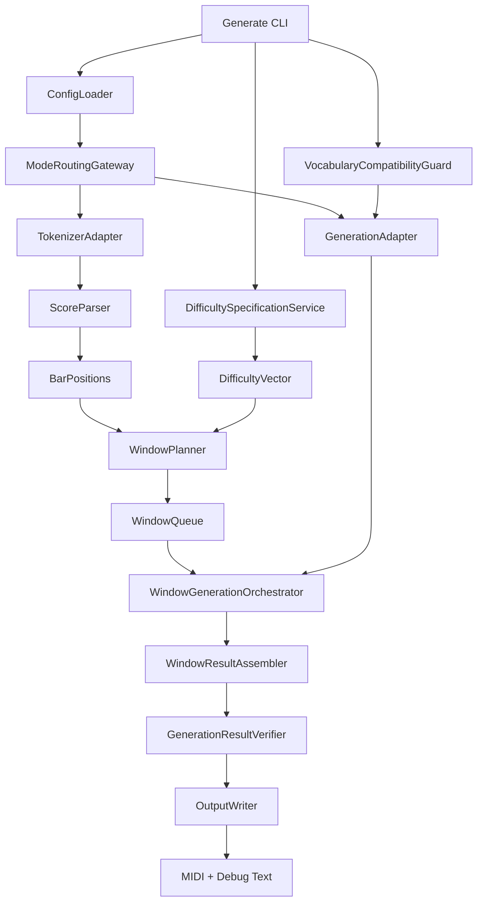
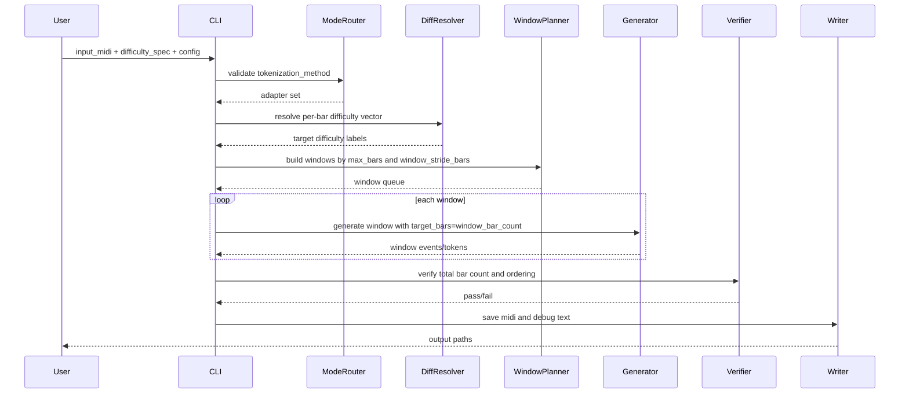

# Design Document

## Overview
本拡張は、学習済み MuseMorphose を用いた「入力譜面ベースの難易度編集生成」を、standard / remi / cp_limb_v1 の3モードで統一運用するための設計である。入力は MIDI と小節難易度指定、出力は難易度修正済みの MIDI とデバッグテキストとする。

長尺譜面対応の要点は、config の max_bars をウィンドウ幅、window_stride_bars をスライド幅とする小節単位スライディングである。トークン長ベースの切り捨てではなく、小節境界を保持したウィンドウ分割で生成し、各ウィンドウの target_bars を正規化することで「複数小節入力なのに1小節しか生成されない」不具合を防ぐ。

### Goals
- 入力MIDI + 小節難易度指定から編集済みMIDIを安定生成する。
- 難易度指定方式を「全小節指定 / 全体シフト / 上限値設定」の3方式で統一提供する。
- max_bars（ウィンドウ幅）と window_stride_bars（スライド幅）で長尺譜面を処理する。
- standard / remi / cp_limb_v1 を単一CLI契約で扱う。
- 語彙不整合を生成前に fail-fast で検出する。

### Non-Goals
- 学習アルゴリズムや損失関数の変更。
- 新しい tokenization_method の追加。
- チェックポイント重みの自動変換。
- リアルタイム生成やストリーミング出力。

## Architecture

### Existing Architecture Analysis
- 既存の入力譜面生成は scripts 層で mode 分岐し、src 層の tokenizer / dataloader / model を呼び出す構成。
- cp_limb_v1 は multi-head 出力（event/type/pos/limb）を持ち、standard/remi は単系列または構造系列中心の入出力を取る。
- 既存不具合は target_bars 設定と終了条件の扱いが窓ごとに一貫しない点で再発しやすい。

### Architecture Pattern & Boundary Map

**Architecture Integration**:
- Selected pattern: Pipeline Orchestration + Mode Adapter
- Domain boundaries: Mode Routing, Difficulty Resolution, Window Planning, Window Merge, Generation Execution, Output Commit
- Existing patterns preserved: config-first、tokenization_method 分岐、checkpoint ロード
- New components rationale: 難易度指定解決と小節窓管理を明示境界として分離し、バグ再発を防止
- Steering compliance: scripts はオーケストレーション、src はドメイン処理を維持



### Technology Stack

| Layer | Choice / Version | Role in Feature | Notes |
|-------|------------------|-----------------|-------|
| CLI / Pipeline | Python scripts | 入力解析、mode選択、生成実行 | 既存 generate スクリプト拡張 |
| Tokenization | DrumTokenizer / RemiDrumTokenizer / DrumCPTokenizer | モード別の入力表現生成 | tokenization_method で選択 |
| Model Runtime | PyTorch MuseMorphose | 小節難易度条件付き生成 | checkpoint 利用 |
| Data Contract | pickle vocab + config + midi | 語彙整合と出力契約 | fail-fast 検証追加 |
| Output | miditoolkit | MIDI 書き込み | 親ディレクトリ自動作成 |

## System Flows



フロー上の重要判断:
- 生成前に mode と語彙整合を検証し、無効構成を実行しない。
- スライディングは max_bars（幅）と window_stride_bars（移動量）で制御する。
- `window_stride_bars <= max_bars` を必須とし、未指定時は `window_stride_bars = max_bars` とする。
- ウィンドウごとに target_bars を再計算し、1小節生成への退行を防止する。

## Requirements Traceability

| Requirement | Summary | Components | Interfaces | Flows |
|-------------|---------|------------|------------|-------|
| 1.x | 入出力契約 | ModeRoutingGateway, OutputWriter | CLI Contract | End-to-end sequence |
| 2.x | 3種類の難易度指定 | DifficultySpecificationService | Difficulty Spec API | Resolve step |
| 3.x | max_bars + stride 分割生成 | WindowPlanner, WindowGenerationOrchestrator, WindowResultAssembler | Window Plan Contract | Window loop |
| 4.x | 1小節生成バグ修正 | DecoderTerminationGuard, GenerationResultVerifier | Guard Interface | Window generation |
| 5.x | 語彙整合検証 | VocabularyCompatibilityGuard | Validation Contract | Preflight |
| 6.x | 保存先自動作成 | OutputWriter | File Output Contract | Final write |
| 7.x | 3モード対応 | ModeRoutingGateway, TokenizerAdapter | Mode Adapter Contract | Preflight + generate |

## Components and Interfaces

| Component | Domain/Layer | Intent | Req Coverage | Key Dependencies (P0/P1) | Contracts |
|-----------|--------------|--------|--------------|--------------------------|-----------|
| ModeRoutingGateway | Scripts | tokenization_method の妥当性検証と経路選択 | 1, 7 | config loader P0, adapters P0 | Service, State |
| DifficultySpecificationService | Domain | 3方式の難易度指定を最終小節ラベル列へ解決 | 1, 2 | difficulty labels P0 | Service |
| VocabularyCompatibilityGuard | Validation | モデル語彙と入力語彙の整合確認 | 5, 7 | vocab payload P0, model config P0 | Service |
| WindowPlanner | Domain | max_bars と stride に基づく小節ウィンドウ計画 | 3 | bar positions P0 | Service, Batch |
| WindowGenerationOrchestrator | Runtime | 窓ごとの生成呼び出しと連結 | 3, 4 | MuseMorphose adapter P0 | Batch, State |
| WindowResultAssembler | Runtime | 重複窓のマージと境界整形 | 3, 4 | window outputs P0 | Service, State |
| DecoderTerminationGuard | Runtime | 早期終了を抑止し target_bars まで生成継続 | 4 | generation loop P0 | Service |
| GenerationResultVerifier | Validation | 生成小節数と順序の検証 | 3, 4 | assembled result P0 | Service |
| OutputWriter | IO | 出力ディレクトリ作成と保存 | 1, 6 | miditoolkit P0 | Service |

### Scripts Layer

#### ModeRoutingGateway

| Field | Detail |
|-------|--------|
| Intent | mode検証と adapter 解決を一元化する |
| Requirements | 1.4, 7.1, 7.2, 7.3, 7.4, 7.5 |

**Responsibilities & Constraints**
- 許可モードは standard / remi / cp_limb_v1 のみ。
- 不正モードでは利用可能一覧付きで fail-fast。
- 下流へ mode 固有 adapter を返す。

##### Service Interface
```python
class ModeRoutingGateway:
    def resolve(self, tokenization_method: str) -> "GenerationAdapter": ...
```

#### DifficultySpecificationService

| Field | Detail |
|-------|--------|
| Intent | 3方式入力を最終的な per-bar difficulty 配列へ変換 |
| Requirements | 2.1, 2.2, 2.3, 2.4, 2.5 |

**Responsibilities & Constraints**
- full_assign: 入力配列長 = 小節数を要求。
- global_shift: 元ラベルへ一律オフセット適用。
- upper_cap: しきい値超過を cap。
- 方式ごとの必須引数不足は停止。

##### Service Interface
```python
from typing import List, Literal

DifficultyMode = Literal["full_assign", "global_shift", "upper_cap"]

class DifficultySpecificationService:
    def resolve(
        self,
        mode: DifficultyMode,
        source_labels: List[int],
        n_bars: int,
        target_labels: List[int] | None = None,
        shift: int | None = None,
        cap: int | None = None,
    ) -> List[int]: ...
```

### Validation Layer

#### VocabularyCompatibilityGuard

| Field | Detail |
|-------|--------|
| Intent | 生成前に語彙契約を検証し不一致を遮断 |
| Requirements | 5.1, 5.2, 5.3, 5.4 |

**Responsibilities & Constraints**
- standard/remi: token vocab size と special token 整合を確認。
- cp_limb_v1: event/type/pos/limb の各語彙と pad index を検証。
- 不一致時は差分（expected/actual）を明示。

##### Service Interface
```python
class VocabularyCompatibilityGuard:
    def validate(self, mode: str, model_meta: dict, vocab_meta: dict) -> None: ...
```

### Window Runtime Layer

#### WindowPlanner

| Field | Detail |
|-------|--------|
| Intent | max_bars と stride に基づく分割計画を生成 |
| Requirements | 3.1, 3.2, 3.3 |

**Responsibilities & Constraints**
- 入力小節を [start_bar, end_bar) 区間へ分割。
- 開始位置は `start = k * window_stride_bars` とし、区間幅は `max_bars` とする。
- 最終窓は短小節数を許容。
- 難易度配列と bar_positions を同じ区間で切り出す。
- `window_stride_bars <= max_bars` を検証し、不正値は fail-fast とする。

##### Batch / Job Contract
- Trigger: 生成開始時。
- Input / validation: n_bars > 0, max_bars > 0, window_stride_bars > 0, window_stride_bars <= max_bars。
- Output / destination: ordered windows。
- Idempotency & recovery: 同一入力なら同一 window plan。

#### WindowGenerationOrchestrator

| Field | Detail |
|-------|--------|
| Intent | 窓ごとの生成を実行し順序連結 |
| Requirements | 3.2, 3.4, 4.1, 4.3 |

**Responsibilities & Constraints**
- 各窓で target_bars = window_bar_count を明示設定。
- 生成結果を bar 単位で連結。
- 例外窓は窓ID付きで失敗報告。

#### WindowResultAssembler

| Field | Detail |
|-------|--------|
| Intent | stride により重複した小節領域を一意な系列へ整形 |
| Requirements | 3.2, 3.4, 4.4 |

**Responsibilities & Constraints**
- 重複領域がある場合は先行窓優先または後続窓優先の方針を固定適用する。
- 出力の bar 順序を単調増加で保持する。
- マージ後に総小節数を検証器へ渡す。

#### DecoderTerminationGuard

| Field | Detail |
|-------|--------|
| Intent | 早期EOSや誤終了条件による1小節化を防止 |
| Requirements | 4.2, 4.3, 4.4 |

**Responsibilities & Constraints**
- EOS を受けても target_bars 未達なら継続生成。
- 窓完了時に生成 bar 数を検証。

#### GenerationResultVerifier

| Field | Detail |
|-------|--------|
| Intent | 生成件数を入力件数と一致検証 |
| Requirements | 3.4, 4.4 |

**Responsibilities & Constraints**
- 総生成 bar 数 == 入力 bar 数。
- 欠落・重複・順序入れ替えを検出。

### IO Layer

#### OutputWriter

| Field | Detail |
|-------|--------|
| Intent | 保存先ディレクトリを保証して成果物を書き込む |
| Requirements | 6.1, 6.2, 6.3, 6.4 |

**Responsibilities & Constraints**
- `os.makedirs(parent, exist_ok=True)` 相当の再帰作成。
- MIDI と debug text を同一プレフィックスで保存。
- ファイルIO失敗は原因付きで返却。

## Data Models

### Domain Model
- InputScore: 入力MIDIと bar_positions。
- DifficultySpec: 指定方式とパラメータ。
- WindowPlan: start_bar, end_bar, source slice, difficulty slice。
- WindowResult: 生成トークン/CPイベントと bar_count。
- MergedResult: 全窓連結後の最終譜面。

### Logical Data Model

```python
from dataclasses import dataclass
from typing import List, Literal

@dataclass
class DifficultySpec:
    mode: Literal["full_assign", "global_shift", "upper_cap"]
    target_labels: List[int] | None = None
    shift: int | None = None
    cap: int | None = None

@dataclass
class WindowPlan:
    window_id: int
    start_bar: int
    end_bar: int
    target_bars: int
    difficulty_labels: List[int]
```

## Risks and Mitigations
- Risk: window 境界で拍情報が崩れて接続が不自然になる。
  - Mitigation: bar境界でのみ分割し、連結後に bar count と順序検証を実施する。
- Risk: mode ごとの語彙仕様差分を見落とす。
  - Mitigation: preflight で mode別語彙検証を必須化する。
- Risk: 早期EOSで再び1小節生成へ退行する。
  - Mitigation: DecoderTerminationGuard と回帰テストを必須にする。

## Supporting References
- scripts/generate/generate_drum_from_input.py
- scripts/generate/generate_drum_cp.py
- src/data/drum_dataloader.py
- src/utils/drum_to_midi.py
