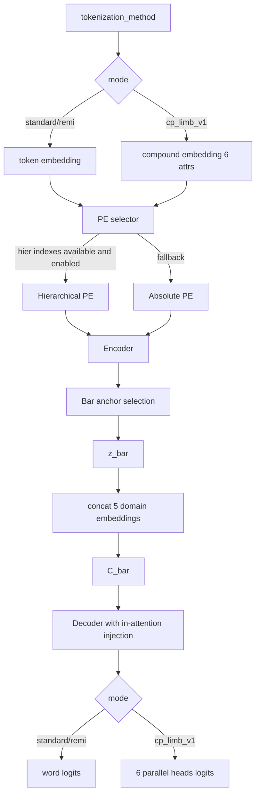

# Design Document

## Overview
本設計は、MuseMorphose のモデルを tokenization_method ごとに拡張しつつ、既存の学習資産を壊さないことを最優先にする。standard/remi は既存の単語列入力を維持し、cp_limb_v1 は 6 次元 Compound Word 入力を導入する。さらに、bar/beat/pos 階層 Positional Encoding を optional 機能として追加し、デフォルトは既存絶対 PE を維持する。

### Goals
- standard/remi/cp_limb_v1 を共通の Encoder -> latent -> Decoder フローで運用する。
- cp_limb_v1 の入力を 6 属性埋め込み結合 + 線形射影で d_model に統合する。
- 小節潜在 z_bar の抽出アンカーを明示し、Bar アンカー優先かつ既存先頭トークンアンカーへ後方互換フォールバック可能にする。
- decoder 各層へ C_bar を小節単位で注入できる設計にする。
- cp_limb_v1 で 6 独立 head による並列予測を可能にする。
- 階層 PE を optional で導入し、既存 PE へ安全にフォールバックする。
- tokenizer/dataloader/generate で階層インデックスを整合的に受け渡す。

### Non-Goals
- 既存 MuseMorphose の潜在変数意味論そのものの変更。
- 既存 checkpoint の重み構造を破壊する必須変更。
- 非ドラム用途への一般化。

## Architecture

### Affected Components
1. src/models/transformer_helpers.py
- HierarchicalDrumPositionalEncoding を追加する。
- 入力は bar_idx, beat_idx, pos_idx, is_struct を想定する。
- 出力は PE_bar + PE_beat + PE_pos（必要に応じて構造イベント補正）とする。

2. src/models/musemorphose.py
- forward/generate に階層 PE 用テンソルを optional で追加する。
- standard/remi は token embedding、cp_limb_v1 は compound embedding を使い、PE 選択ロジックを共通化する。
- use_hierarchical_pe=false または情報欠損時は既存絶対 PE にフォールバックする。

3. src/data/drum_dataloader.py
- standard/remi/cp_limb_v1 で共通に bar_idx/beat_idx/pos_idx/is_struct を返せるインターフェースを定義する。
- 既存戻り値形式との互換を保つため optional 追加フィールド方式を採用する。

4. src/tokenizers/drum_tokenizer.py
- standard/remi 系列を生成する際に階層インデックスを同時構築する。
- Beat=1..4, Pos=0..23 を canonical 定義として返却する。

5. src/tokenizers/drum_cp_tokenizer.py
- cp_limb_v1 系列生成時に、Type/Position/4 肢に対応する 6 次元系列と階層インデックスを同時返却する。

6. scripts/train_drum.py, scripts/generate_drum.py（または該当生成スクリプト）
- 新規テンソルの受け渡しを追加する。
- 既存引数のみでも動作する後方互換分岐を維持する。

### Logical Flow

## Detailed Design

### 1. cp_limb_v1 Input Embedding
- 各属性 embedding を個別に定義する。
- 6 つの埋め込みを concatenate して linear projection で d_model へ射影する。

数式:

$$
X_t = W_{cp}[E_{type}(x_t^{type}) \oplus E_{pos}(x_t^{pos}) \oplus E_{h1}(x_t^{h1}) \oplus E_{h2}(x_t^{h2}) \oplus E_{rf}(x_t^{rf}) \oplus E_{lf}(x_t^{lf})] + b_{cp}
$$

### 2. Bar-anchor Latent Extraction with Fallback
- 小節ごとに 1 つの潜在 z_bar を導出するアンカー選択器を導入する。
- Bar アンカー抽出が有効で小節内 <Bar> が一意に特定できる場合は、その hidden state を z_bar 導出に使用する。
- Bar アンカー抽出が無効、または <Bar> を一意に特定できない場合は、既存互換として小節先頭トークン hidden state を z_bar 導出に使用する。
- 小節内 token へ z_bar をブロードキャストできる index map を持つ。

アンカー選択規則:
- 優先 1: `bar_anchor_mode=bar_token` かつ有効な <Bar> 位置が存在
- 優先 2: `bar_anchor_mode=first_token`（既定）または上記条件未充足時

### 3. Conditioning Vector
- 既存難易度条件 embedding（5 種）との結合を維持する。
- 小節ごとの条件付けベクトル C_bar を生成する。

数式:

$$
C_{bar} = z_{bar} \oplus E_{domain_1} \oplus E_{domain_2} \oplus E_{domain_3} \oplus E_{domain_4} \oplus E_{domain_5}
$$

### 4. Decoder In-Attention
- Decoder 各層で masked self-attention 前後の既存注入ポイントを再利用し、該当小節の C_bar を加算または結合投影で注入する。
- 自己回帰マスクは既存ロジックを維持する。

### 5. Output Heads
- standard/remi: 既存単語語彙 head を維持。
- cp_limb_v1: Type/Position/Hand1/Hand2/Right_Foot/Left_Foot の 6 head を定義し、それぞれ独立 logits を返す。

### 6. Positional Encoding Selector
- 設定: use_hierarchical_pe（default false）
- 階層 PE 設定: hier_pe_bar_vocab_size, hier_pe_beat_vocab_size, hier_pe_pos_vocab_size
- 選択規則:
  - use_hierarchical_pe=true かつ階層テンソルが揃う場合: hierarchical PE
  - それ以外: absolute PE

### 7. Generate State Manager
- 自己回帰生成中の状態として bar_idx/beat_idx/pos_idx を保持する。
- 更新規則:
  - <BAR> 生成: bar_idx += 1, beat_idx = 1, pos_idx = 0
  - <BEAT_n> 生成: beat_idx = n, pos_idx = 0
  - Note 生成: pos_idx を進行し、拍境界超過時は beat_idx を更新
- 状態が確定できない場合は absolute PE 経路へフォールバックする。

## Compatibility and Migration
- 既定値は use_hierarchical_pe=false とし、既存設定を無変更で起動可能にする。
- 既存 checkpoint は absolute PE 経路で再利用する。
- dataloader の戻り値拡張は optional フィールドで行い、既存 unpack 実装を壊さない。
- 小節潜在アンカーは `bar_anchor_mode=first_token` を既定とし、既存学習挙動を維持する。

## Risks and Mitigations
1. リスク: 生成時 index 更新ミスで拍・小節整合が崩れる。
- 対策: 状態遷移テストを追加し、<BAR>/<BEAT>/<Note> の遷移表で検証する。

2. リスク: cp 6 head の shape 不一致による loss 計算失敗。
- 対策: 各 head の logits/target shape を統合テストで固定する。

3. リスク: 階層 PE 導入で既存モデルとの挙動差が増える。
- 対策: デフォルト false、回帰比較時は同一 seed で loss 推移を監視する。

## Test Strategy
1. 単体テスト
- HierarchicalDrumPositionalEncoding の shape と合成結果。
- PE selector のフォールバック分岐。
- generate state manager の遷移。

2. 結合テスト
- standard/remi/cp_limb_v1 で 1-step train が完走する。
- dataloader 出力と model 入力の shape 一致。
- cp 6 head logits の型・次元整合。

3. 回帰テスト
- use_hierarchical_pe=false で既存学習挙動と大きな乖離がないこと。
- 既存生成スクリプトが新引数なしで実行可能であること。
