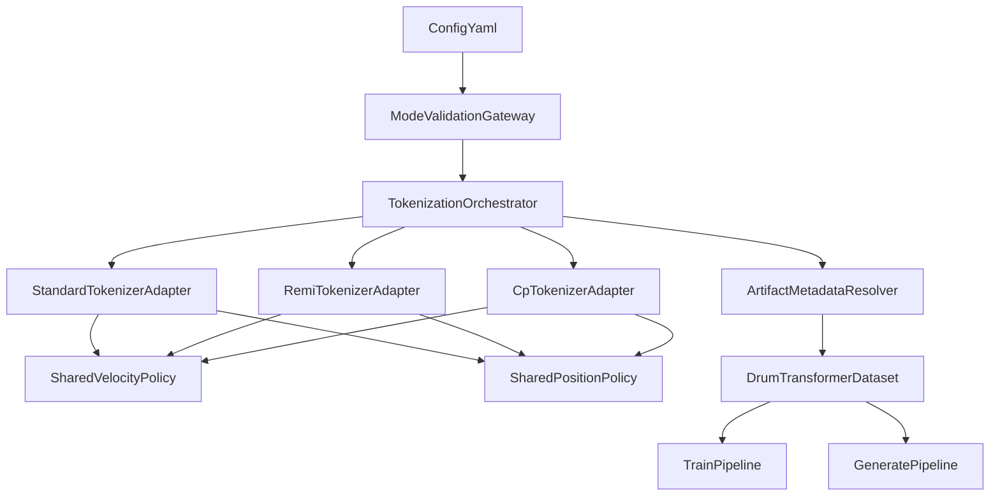
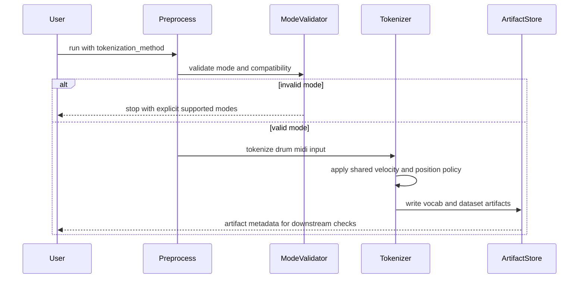
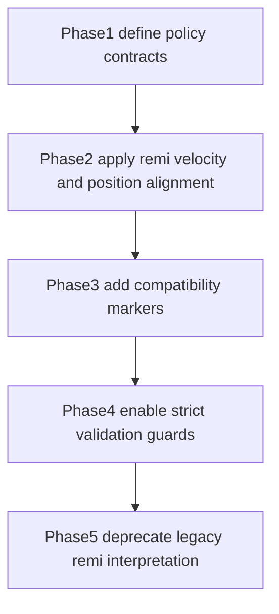

# Design Document

## Overview
本機能は、ドラム向けトークン化方式の拡張要件を既存パイプラインへ安全に統合するための設計である。対象は standard、remi、cp_limb_v1 の3方式であり、モード選択を一貫した制御面で維持しつつ、速度と Position の意味論を仕様に合わせて統一する。

本設計の中心価値は、既存資産を壊さないことと、モード間比較の意味論を揃えることにある。特に standard は既存の運用・テスト資産に依存しているため互換維持を最優先とし、remi と cp_limb_v1 は Position と速度の双方で standard 規則を厳密に採用する。

### Goals
- tokenization_method を単一制御面として維持し、前処理・学習・生成で同一解釈を保証する。
- remi と cp_limb_v1 のベロシティ規則を standard 3分割へ統一する（Ghost <15, Normal <100, Accent >=100）。
- remi と cp_limb_v1 の Position 設計を standard と同一の量子化規則へ固定する。
- CP のハイハット Left_Foot は状態遷移時のみ HH_PEDAL_HIT_Down/Up を記述し、状態変化なし時は `<NONE>` とする。
- CP のドラム楽器語彙にタンバリン（Pitch 54）を追加し、Hand スロットで統一的に符号化可能にする。
- standard モードの後方互換性と既存テスト整合を維持する。
- モード不一致や成果物不整合を早期検出する検証契約を追加する。

### Non-Goals
- 非ドラム楽器の取り扱い拡張。
- 新規モデルアーキテクチャ（Transformer 構造）変更。
- tokenization_method を廃止する大規模リファクタ。
- 既存 checkpoint の内部重み構造変更。

## Architecture

### Existing Architecture Analysis
- 既存は scripts 層で tokenization_method を分岐し、src 層の tokenizer/dataloader/model へ受け渡す構成。
- preprocess では tokenizer インスタンス選択、train では許可モード検証、generate では CP 専用経路が独立。
- cp_limb_v1 は語彙 payload が dict 形式、standard/remi は tuple 形式であり、dataloader がこの差を吸収している。

### Architecture Pattern & Boundary Map

**Architecture Integration**:
- Selected pattern: 既存 Layered Pipeline 拡張（scripts orchestration + src domain modules）
- Domain boundaries: Mode Validation、Tokenization Policy、Artifact Compatibility を分離
- Existing patterns preserved: config-first、python -m 実行、mode-based branching
- New components rationale: 仕様統一に必要な共有ポリシー契約と検証境界を追加
- Steering compliance: src に再利用ロジック、scripts に実行責務を維持



### Technology Stack

| Layer | Choice / Version | Role in Feature | Notes |
|-------|------------------|-----------------|-------|
| CLI / Pipeline | Python scripts | モード解釈と実行オーケストレーション | 既存 scripts を拡張 |
| Tokenization | DrumTokenizer, RemiDrumTokenizer, DrumCPTokenizer | モード別トークン列生成 | 共通ポリシー契約を導入 |
| Data | pickle artifacts + DrumTransformerDataset | 成果物読込と schema 分岐 | 既存 payload 互換維持 |
| Training | PyTorch train_drum | mode-aware バッチ供給 | 不正モード停止契約 |
| Generation | generate_drum_cp and related scripts | モード別生成経路 | CP 専用経路維持 |

## System Flows



フロー上の重要判断:
- validation は tokenize 前に実行し fail-fast を徹底する。
- Position と velocity は mode 内部でなく shared policy 契約で統一する。
- 成果物には下流で検証可能な mode/version 情報を保持する。

## Requirements Traceability

| Requirement | Summary | Components | Interfaces | Flows |
|-------------|---------|------------|------------|-------|
| 1.1, 1.2, 1.3, 1.4, 1.5 | モード共存と選択一貫性 | ModeValidationGateway, TokenizationOrchestrator | ModeValidation API, PipelineGuard State | Preprocess validation flow |
| 2.1, 2.2, 2.3, 2.4, 2.5 | ドラム向け REMI と速度/Position 統一 | RemiTokenizerAdapter, SharedVelocityPolicy, SharedPositionPolicy | Tokenization Service, Artifact Contract | Preprocess tokenize flow |
| 3.1, 3.2, 3.3, 3.4, 3.5 | standard 後方互換維持 | StandardTokenizerAdapter, CompatibilityGuard | Compatibility API, Validation Contract | Train/Generate load flow |
| 4.1, 4.2, 4.3, 4.4, 4.5, 4.6, 4.7 | CP 6次元固定と Position/速度整合 | CpTokenizerAdapter, SharedPositionPolicy, SharedVelocityPolicy | CP Schema Contract, Policy Interface | CP tokenize and generate flow |
| 5.1, 5.2, 5.3, 5.4, 5.5 | 四肢意味論整合 | CpTokenizerAdapter | CP Limb Assignment Contract | CP tokenize flow |
| 6.1, 6.2, 6.3, 6.4, 6.5 | 検証可能性と成果物整合 | ArtifactMetadataResolver, SchemaValidator, PipelineCompatibilityGuard | Artifact Metadata Contract, Error Contract | Train/Generate compatibility checks |

## Components and Interfaces

| Component | Domain/Layer | Intent | Req Coverage | Key Dependencies (P0/P1) | Contracts |
|-----------|--------------|--------|--------------|--------------------------|-----------|
| ModeValidationGateway | Scripts Orchestration | tokenization_method を一元検証 | 1.x, 6.2 | config loader P0, train/generate entry P0 | Service, State |
| TokenizationOrchestrator | Preprocess | モード別 tokenizer を選択し成果物を生成 | 1.x, 2.x, 4.x, 6.1 | tokenizer adapters P0 | Service, Batch |
| SharedVelocityPolicy | Token Policy | standard 3分割規則を全モードに提供 | 2.2, 4.6 | DrumTokenizer thresholds P0 | Service |
| SharedPositionPolicy | Token Policy | standard 準拠 Position 規則を提供 | 4.3, 4.7 | POSITIONS_PER_BEAT P0 | Service |
| StandardTokenizerAdapter | Tokenization | standard 仕様維持 | 3.x | DrumTokenizer P0 | Service |
| RemiTokenizerAdapter | Tokenization | ドラム向け remi 仕様適用（速度/Position を standard 準拠化） | 2.x | RemiDrumTokenizer P0, SharedVelocityPolicy P0, SharedPositionPolicy P0 | Service |
| CpTokenizerAdapter | Tokenization | CP 6次元表現と四肢意味論維持、HH_PEDAL状態遷移とタンバリン対応 | 4.x, 5.x, 7.x | DrumCPTokenizer P0, Shared policies P0 | Service |
| ArtifactMetadataResolver | Data Contract | mode/version/schema 情報を成果物へ反映 | 6.1, 6.5 | pickle writer P0 | API, State |
| PipelineCompatibilityGuard | Train/Generate Guard | 学習・生成前に成果物整合を検証 | 1.4, 6.2, 6.4 | dataloader, vocab payload P0 | Service |

### Scripts Orchestration

#### ModeValidationGateway

| Field | Detail |
|-------|--------|
| Intent | モード値と許可リストを検証し、統一エラーを返す |
| Requirements | 1.1, 1.2, 1.5, 6.2 |

**Responsibilities & Constraints**
- tokenization_method の妥当性判定。
- mode 不一致時の fail-fast。
- 許可値表示を含むエラー規約統一。

**Dependencies**
- Inbound: preprocess/train/generate entry scripts - mode 検証要求 (P0)
- Outbound: shared mode definition - 許可モード参照 (P0)

**Contracts**: Service [x] / API [ ] / Event [ ] / Batch [ ] / State [x]

##### Service Interface
```python
from typing import Literal

TokenizationMode = Literal["standard", "remi", "cp_limb_v1"]

class ModeValidationGateway:
    def validate_mode(self, mode: str) -> TokenizationMode: ...
```
- Preconditions: mode が空文字でないこと。
- Postconditions: 戻り値は許可モードのいずれか。
- Invariants: 許可モード定義は preprocess/train/generate で共通。

### Token Policy Layer

#### SharedVelocityPolicy

| Field | Detail |
|-------|--------|
| Intent | velocity を Ghost/Normal/Accent へ分類する単一規則を提供 |
| Requirements | 2.2, 4.6 |

**Responsibilities & Constraints**
- 閾値を標準規則へ固定。
- remi/cp/standard で同一判定を保証。
- 閾値定義は Ghost <15、Normal <100、Accent >=100 を採用する。

**Dependencies**
- Inbound: RemiTokenizerAdapter, CpTokenizerAdapter, StandardTokenizerAdapter (P0)
- Outbound: none

**Contracts**: Service [x] / API [ ] / Event [ ] / Batch [ ] / State [ ]

##### Service Interface
```python
from typing import Literal

VelocityClass = Literal["Ghost", "Normal", "Accent"]

class SharedVelocityPolicy:
    def classify(self, velocity: int) -> VelocityClass: ...
```
- Preconditions: velocity は 0 以上 127 以下。
- Postconditions: 返却値は3クラスのいずれか。
- Invariants: 閾値定義（Ghost <15、Normal <100、Accent >=100）は全モードで同一。

#### SharedPositionPolicy

| Field | Detail |
|-------|--------|
| Intent | standard と同一の Position 量子化規則を提供 |
| Requirements | 4.3, 4.7 |

**Responsibilities & Constraints**
- 1拍24分割を canonical とする。
- CP と REMI の Position は standard と同一式で算出。
- CP の非 Note イベントでは PAD 位置を使用。

**Dependencies**
- Inbound: StandardTokenizerAdapter, CpTokenizerAdapter, RemiTokenizerAdapter (P0)
- Outbound: none

**Contracts**: Service [x] / API [ ] / Event [ ] / Batch [ ] / State [ ]

##### Service Interface
```python
class SharedPositionPolicy:
    positions_per_beat: int = 24
    cp_pos_pad_value: int = 24

    def quantize(self, tick_in_beat: int, beat_resolution: int) -> int: ...
```
- Preconditions: beat_resolution > 0。
- Postconditions: 返却値は 0..23。
- Invariants: cp_pos_pad_value は Note 以外でのみ使用。

### Tokenization Layer

#### RemiTokenizerAdapter

| Field | Detail |
|-------|--------|
| Intent | ドラム向け remi トークン列を生成し、速度/Position 規則を standard 準拠へ統一 |
| Requirements | 2.1, 2.2, 2.3, 2.5 |

**Responsibilities & Constraints**
- 入力はドラムトラックのみ対象。
- 速度は shared velocity policy で分類。
- Position は shared position policy で量子化する。
- 非ドラムトラックは処理対象外として扱う。

**Dependencies**
- Inbound: TokenizationOrchestrator (P0)
- Outbound: SharedVelocityPolicy (P0), SharedPositionPolicy (P0)

**Contracts**: Service [x] / API [ ] / Event [ ] / Batch [x] / State [ ]

##### Batch / Job Contract
- Trigger: preprocess 実行時に remi モードが選択される。
- Input / validation: ドラム MIDI と mode config。
- Output / destination: remi 仕様トークン列と vocab payload。
- Idempotency & recovery: 同一入力と同一設定で同等のトークン化結果を再現。

#### CpTokenizerAdapter

| Field | Detail |
|-------|--------|
| Intent | CP 6次元イベントを生成し、四肢意味論と Position/速度規則を維持 |
| Requirements | 4.1, 4.2, 4.3, 4.4, 4.5, 4.6, 4.7, 5.1, 5.2, 5.3, 5.4, 5.5 |

**Responsibilities & Constraints**
- 出力次元は常に [Type, Position, Hand1, Hand2, Right_Foot, Left_Foot]。
- STRUCT イベントの Position と limb は PAD を使用。
- Position は shared position policy による 24 分割。
- velocity は shared velocity policy による 3分割。
- ハイハット Left_Foot は状態遷移型：HH_OPEN → HH_CLOSED 時に `HH_PEDAL_HIT_Down`、HH_CLOSED → HH_OPEN 時に `HH_PEDAL_HIT_Up`、状態変化なし時は `<NONE>`。
- タンバリン（Pitch 54）をはじめとする副楽器は Hand1/Hand2 スロットで符号化し、ベロシティは standard 3分割規則を適用。

**Dependencies**
- Inbound: TokenizationOrchestrator (P0)
- Outbound: SharedVelocityPolicy (P0), SharedPositionPolicy (P0)

**Contracts**: Service [x] / API [ ] / Event [ ] / Batch [x] / State [ ]

##### Service Interface
```python
from typing import TypedDict, List

class CpData(TypedDict):
    event_type: List[int]
    struct_token: List[int]
    cp_pos: List[int]
    cp_hand1: List[int]
    cp_hand2: List[int]
    cp_right_foot: List[int]
    cp_left_foot: List[int]

class CpTokenizerAdapter:
    def midi_to_cp_data(self, midi_path: str) -> tuple[CpData, list[int]]: ...
```
- Preconditions: ドラムトラックが存在する。
- Postconditions: 各系列長は一致する。
- Invariants: CP イベントでは cp_pos が 0..23、STRUCT では cp_pos が PAD。

### Compatibility and Validation Layer

#### ArtifactMetadataResolver

| Field | Detail |
|-------|--------|
| Intent | mode/version/schema 判定に必要な成果物識別情報を提供 |
| Requirements | 6.1, 6.5 |

**Responsibilities & Constraints**
- vocab payload と dataset payload の識別子を解決。
- train/generate で整合判定可能な情報を提供。

**Dependencies**
- Inbound: TokenizationOrchestrator, DrumTransformerDataset (P0)
- Outbound: PipelineCompatibilityGuard (P0)

**Contracts**: Service [x] / API [x] / Event [ ] / Batch [ ] / State [x]

##### API Contract
| Method | Endpoint | Request | Response | Errors |
|--------|----------|---------|----------|--------|
| Internal | resolve_artifact_metadata | artifact path list | mode, schema, version summary | incompatible_schema |

#### PipelineCompatibilityGuard

| Field | Detail |
|-------|--------|
| Intent | preprocess 成果物と train/generate 設定の整合を起動前に検証 |
| Requirements | 1.4, 6.2, 6.4 |

**Responsibilities & Constraints**
- mode mismatch で即停止。
- 非選択モード依存要求を排除。
- 原因識別可能なエラー文面を返却。

**Dependencies**
- Inbound: train_drum, generate scripts (P0)
- Outbound: ArtifactMetadataResolver (P0)

**Contracts**: Service [x] / API [ ] / Event [ ] / Batch [ ] / State [x]

## Data Models

### Domain Model
- Aggregate: TokenizationPolicy
  - mode: standard/remi/cp_limb_v1
  - velocity_policy: standard_3level_ghost15_normal100_accent100plus
  - position_policy: standard_24div
- Aggregate: ArtifactCompatibility
  - source_mode
  - schema_kind
  - compatibility_status

### Logical Data Model

**Structure Definition**:
- Standard and remi dataset entry:
  - tuple(bar_positions, token_indices)
- CP dataset entry:
  - tuple(bar_positions, cp_data)
  - cp_data keys: event_type, struct_token, cp_pos, cp_hand1, cp_hand2, cp_right_foot, cp_left_foot

**Consistency & Integrity**:
- 同一サンプル内で cp 系列長は全キー一致。
- cp_pos の有効範囲は 0..23、PAD は 24。
- remi と cp_limb_v1 は standard と同一の Position 量子化規則を満たす必要がある。
- mode と vocab payload 形式は整合している必要がある。

### Physical Data Model
- Storage: pickle files on local filesystem.
- Vocab payload:
  - standard/remi: tuple(token2idx, idx2token)
  - cp_limb_v1: dict with tokenization metadata and vocab maps
- Compatibility marker:
  - tokenization_method and schema identifiers must be available at load-time.

### Data Contracts & Integration
- Preprocess output contract:
  - dataset files and vocab file share mode semantics.
- Train/Generate input contract:
  - config mode must match artifact mode.
  - CP mode requires CP vocab metadata fields.
- Validation contract:
  - incompatible mode or schema triggers fail-fast with explicit reason.

## Error Handling

### Error Strategy
- Fail-fast at pipeline boundary before expensive processing.
- Return mode-aware and artifact-aware diagnostic messages.
- Keep error categories consistent across preprocess/train/generate.

### Error Categories and Responses
- User Errors:
  - Invalid mode value -> list supported modes and stop.
  - Missing drum track -> clear input correction guidance.
- System Errors:
  - Artifact read failure -> include target path and parse context.
  - Schema mismatch -> include expected and actual schema.
- Business Logic Errors:
  - Position out of range -> reject sample and report index.
  - Mode-unsupported flow -> stop and route user to correct script.

### Monitoring
- Log mode, artifact schema summary, and validation decisions at startup.
- Record counts for rejected files during preprocess.
- Keep validation failures visible in training and generation logs.

## Testing Strategy

### Unit Tests
- SharedVelocityPolicy classification thresholds (Ghost <15, Normal <100, Accent >=100).
- SharedPositionPolicy quantization and pad behavior (standard/remi/cp 同一規則).
- ModeValidationGateway valid/invalid mode cases.
- CP schema validator for required fields and aligned lengths.
- Artifact metadata resolver for tuple and dict payloads.
- CP HH_PEDAL_HIT_Down/Up state transition detection (HH_OPEN ↔ HH_CLOSED).
- CP Left_Foot `<NONE>` representation when state unchanged.
- Tambourine（Pitch 54）velocity classification with 3-level policy.
- Tambourine appearance in Hand1/Hand2 slotting.

### Integration Tests
- Preprocess remi with standard velocity and Position policy and downstream load.
- CP tokenize -> dataset load -> train_drum forward path.
- Mode mismatch detection between config and artifacts.
- Standard mode regression against existing fixtures.
- CP generation path rejects non-cp_limb_v1 config.
- CP HH_PEDAL state transition round-trip（MIDI → CP data → MIDI）verification.
- Tambourine token generation and deserialization in CP pipeline.

### E2E / Workflow Tests
- run_all_tests path for standard/remi/cp_limb_v1 end-to-end token round trip.
- Full pipeline smoke: preprocess -> train one epoch -> generate sample.
- Regression check for legacy standard artifacts.
- CP HH_PEDAL state transition round-trip（MIDI → CP data → MIDI）verification.
- Tambourine token generation and deserialization in CP pipeline.

### Performance / Load
- Tokenization throughput comparison before/after remi velocity and Position policy change.
- Memory footprint check for CP data batches.
- Startup validation overhead measurement in train/generate entry points.

## Security Considerations
- Input MIDI paths and artifact paths are treated as untrusted input and validated before access.
- No secrets are introduced by this feature; logs must avoid leaking unrelated environment data.

## Performance & Scalability
- Shared policy functions are O(1) per note and should not materially increase preprocess latency.
- Compatibility checks execute once at startup and should remain negligible relative to training cost.

## Migration Strategy



- Rollout keeps standard and cp behavior stable while remi transitions for both velocity and Position semantics.
- Rollback trigger: significant regression in token round-trip or training compatibility.
- Validation checkpoint: all mode-specific test suites pass before deprecation step.

## Supporting References
- See research log for detailed boundary analysis and option evaluation.
