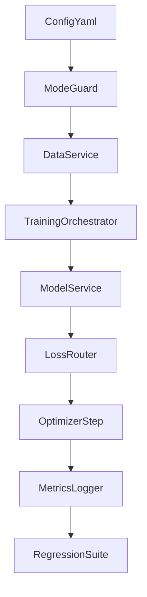
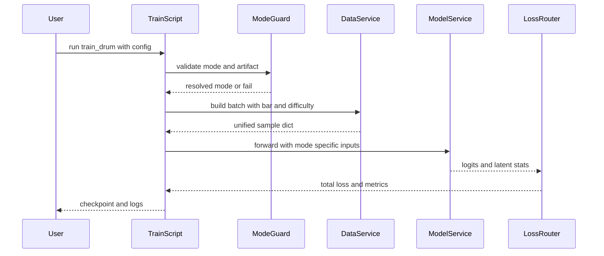

# Design Document

## Overview
本設計は、MuseMorphose のドラム難易度調整学習を `standard`、`remi`、`cp_limb_v1` で統一運用するための技術設計である。既存コードベースにはモード分岐、difficulty 条件、cp multi-head、階層PE互換経路がすでに存在するため、本仕様では境界契約を明確化し、実験再現性と運用安全性を高めることを目的とする。

利用者は主に研究者と運用担当者であり、前処理済みデータセットを使って学習ジョブを反復実行し、モード差分を比較する。変更影響は `scripts/train/train_drum.py` を中心に、`src/data/drum_dataloader.py`、`src/models/musemorphose.py`、`src/utils/tokenization_mode.py` のインタフェース契約へ及ぶ。

### Goals
- モード別入力差分を維持しつつ、学習骨格を単一フローで運用する。
- 小節難易度ラベルを潜在条件へ一貫注入し、標準モードと cp モードで意味論を統一する。
- 既存実行引数と既存チェックポイントの互換性を保持し、回帰検証可能な設計にする。

### Non-Goals
- MuseMorphose の VAE 潜在意味論そのものの再定義。
- cp_limb_v1 の語彙設計やトークナイザ仕様の全面改変。
- 分散学習基盤や外部サービス連携の導入。

## Architecture

### Existing Architecture Analysis
- 学習起動は `scripts/train/train_drum.py` に集約され、データ供給は `DrumTransformerDataset`、モデルは `MuseMorphose` が担う。
- `src/utils/tokenization_mode.py` に mode 検証と artifact 整合の共通ガードがあり、学習・生成の入口で再利用される。
- `src/data/drum_dataloader.py` は共通キーを維持しつつ cp 専用キーと difficulty 展開キーを追加する拡張方式で実装されている。

### Architecture Pattern & Boundary Map
**Architecture Integration**:
- Selected pattern: 既存パイプライン拡張型（script orchestration + src domain modules）
- Domain boundaries: 起動検証、データ整列、条件付けモデル、損失計算、検証系を分離
- Existing patterns preserved: config-first、mode validation、optional field による互換拡張
- New components rationale: 設計上の契約単位を明文化し、将来の実装分割を容易にする
- Steering compliance: `src` にコアロジック、`scripts` に実行境界を維持



### Technology Stack

| Layer | Choice / Version | Role in Feature | Notes |
|-------|------------------|-----------------|-------|
| CLI / Pipeline | Python scripts | 学習ジョブ起動と設定解決 | `scripts/train/train_drum.py` |
| Backend / Services | PyTorch | forward、loss、最適化 | 既存 `MuseMorphose` を継続利用 |
| Data / Storage | Pickle dataset + YAML config | 学習入力と設定管理 | モード整合メタデータを利用 |
| Messaging / Events | なし | 非同期連携なし | バッチ実行のみ |
| Infrastructure / Runtime | Local Python runtime | CPU/CUDA 実行 | 既存環境に準拠 |

## System Flows



フロー上の設計判断:
- ガード失敗時は学習を開始せず停止する。
- Data Service は常に共通キーを返し、モード専用キーは追加提供する。
- Loss Router は mode により `compute_loss` と `compute_cp_loss` を切り替える。

## Requirements Traceability

| Requirement | Summary | Components | Interfaces | Flows |
|-------------|---------|------------|------------|-------|
| 1.1 | 起動時に指定モードのみ有効化 | TrainingOrchestrator, RuntimeModeGuard | RuntimeModeValidationService | Startup sequence |
| 1.2 | 不正モードは停止 | RuntimeModeGuard | RuntimeModeValidationService | Startup sequence |
| 1.3 | 単一ジョブでモード混在禁止 | TrainingOrchestrator, DataService | TrainingBatchContract | Training sequence |
| 1.4 | Encoder latent Decoder 骨格維持 | ModelService | ModelForwardService | Training sequence |
| 2.1 | 小節難易度列を提供 | DataService | DifficultyLabelAlignmentService | Batch build flow |
| 2.2 | 小節数と難易度数不一致で停止 | DataService | DifficultyLabelAlignmentService | Batch build flow |
| 2.3 | 難易度と小節境界を一意対応 | DataService, ModelService | DifficultyConditionContract | Training sequence |
| 2.4 | 全モードで小節粒度難易度供給 | DataService | TrainingBatchContract | Batch build flow |
| 3.1 | standard remi で潜在と難易度を結合 | ModelService | DecoderConditionComposer | Training sequence |
| 3.2 | 自己回帰再構成で小節対応維持 | ModelService | DecoderConditionComposer | Training sequence |
| 3.3 | 難易度無効時に互換フォールバック | ModelService | DecoderConditionComposer | Training sequence |
| 3.4 | 条件結合でも既存再構成維持 | ModelService | ModelForwardService | Training sequence |
| 4.1 | cp 構造を既存拡張モデルで再利用 | ModelService | CPForwardContract | Training sequence |
| 4.2 | cp でも同一学習ループ手順 | TrainingOrchestrator | TrainingLoopService | Training sequence |
| 4.3 | cp 設定欠落時に開始拒否 | TrainingOrchestrator, RuntimeModeGuard | RuntimeModeValidationService | Startup sequence |
| 4.4 | cp で難易度意味論を統一 | DataService, ModelService | DifficultyConditionContract | Training sequence |
| 5.1 | standard remi 損失を計算 | LossRouter | StandardLossService | Loss branch flow |
| 5.2 | cp 損失を計算 | LossRouter | CPLossService | Loss branch flow |
| 5.3 | 出力形状不整合を失敗記録 | LossRouter, MetricsService | LossValidationContract | Loss branch flow |
| 5.4 | モード別損失を同一ログで追跡 | MetricsService | TrainingMetricsContract | Training sequence |
| 6.1 | 既存引数で互換実行 | TrainingOrchestrator | TrainingConfigContract | Startup sequence |
| 6.2 | 設定で難易度有効無効切替 | TrainingOrchestrator, DataService | TrainingConfigContract | Startup sequence |
| 6.3 | 無効設定組み合わせは検証エラー | RuntimeModeGuard | RuntimeModeValidationService | Startup sequence |
| 6.4 | モード語彙不一致を起動前検出 | RuntimeModeGuard | RuntimeModeValidationService | Startup sequence |
| 7.1 | 全モード1-step学習完走検証 | RegressionValidationSuite | TrainingSmokeTestContract | Test flow |
| 7.2 | 互換モード継続動作検証 | RegressionValidationSuite | CompatibilityTestContract | Test flow |
| 7.3 | 閾値超過差分を失敗扱い | RegressionValidationSuite, MetricsService | RegressionMetricContract | Test flow |
| 7.4 | モード別受入結果を記録 | RegressionValidationSuite | TestReportContract | Test flow |

## Components and Interfaces

| Component | Domain/Layer | Intent | Req Coverage | Key Dependencies (P0/P1) | Contracts |
|-----------|--------------|--------|--------------|--------------------------|-----------|
| TrainingOrchestrator | Pipeline | 学習ジョブの起動制御と mode 分岐 | 1.1, 1.3, 4.2, 6.1 | RuntimeModeGuard P0, DataService P0, ModelService P0 | Service, Batch |
| RuntimeModeGuard | Validation | mode と artifact の整合検証 | 1.2, 4.3, 6.3, 6.4 | TokenizationMetadata P0 | Service |
| DataService | Data | モード別バッチ生成と difficulty 展開 | 2.1, 2.3, 2.4, 4.4 | DatasetArtifacts P0 | Service, Batch, State |
| ModelService | Model | latent 条件結合と mode 別 forward | 1.4, 3.1, 3.2, 3.4, 4.1 | DataService P0 | Service, State |
| LossRouter | Model | standard と cp の損失選択 | 5.1, 5.2, 5.3 | ModelService P0 | Service |
| MetricsService | Observability | 学習メトリクス集約とログ保存 | 5.4, 7.3 | LossRouter P0 | Service, State |
| RegressionValidationSuite | Test | 互換と回帰の自動検証 | 7.1, 7.2, 7.4 | Tests P0, MetricsService P1 | Batch, State |

### Pipeline Layer

#### TrainingOrchestrator

| Field | Detail |
|-------|--------|
| Intent | 設定読み込みからエポック学習までを統括する |
| Requirements | 1.1, 1.3, 4.2, 6.1, 6.2 |

**Responsibilities & Constraints**
- config から mode と difficulty 設定を確定する。
- `DrumTransformerDataset` と `MuseMorphose` の引数整合を保証する。
- 単一実行中の mode 混在を禁止する。

**Dependencies**
- Inbound: CLI invocation — 実行要求受付 (P0)
- Outbound: RuntimeModeGuard — 起動前整合検証 (P0)
- Outbound: DataService — 学習バッチ提供 (P0)
- Outbound: ModelService — forward と loss の実行 (P0)

**Contracts**: Service [x] / API [ ] / Event [ ] / Batch [x] / State [ ]

##### Service Interface
```python
class TrainingLoopService(Protocol):
    def run_training(config: dict, device: str) -> dict:
        ...
```
- Preconditions: config に `data`, `model`, `training` が存在し、tokenization_method が有効値である。
- Postconditions: モデルパラメータとログが保存される。
- Invariants: 1ジョブ中は mode が不変である。

##### Batch / Job Contract
- Trigger: `python -m scripts.train.train_drum --config <path>`
- Input / validation: YAML 設定、vocab、dataset split
- Output / destination: checkpoint、training log、best validation metrics
- Idempotency & recovery: 同一 seed と設定で再実行可能、失敗時は途中 checkpoint から再開可能

**Implementation Notes**
- Integration: 既存 `train_drum.py` を主オーケストレータとして維持。
- Validation: 起動前に RuntimeModeGuard を必ず呼ぶ。
- Risks: config と artifact の取り違えで mode 不一致が発生し得る。

#### RuntimeModeGuard

| Field | Detail |
|-------|--------|
| Intent | tokenization mode と artifact metadata の整合を強制する |
| Requirements | 1.2, 4.3, 6.3, 6.4 |

**Responsibilities & Constraints**
- `validate_tokenization_method` で mode 値を正規化する。
- `ensure_runtime_mode_compatibility` で vocab と dataset metadata の一致を確認する。
- 不整合時は学習開始前に fail-fast する。

**Dependencies**
- Inbound: TrainingOrchestrator — 起動前チェック要求 (P0)
- External: tokenization metadata file — artifact 判定 (P0)

**Contracts**: Service [x] / API [ ] / Event [ ] / Batch [ ] / State [ ]

##### Service Interface
```python
class RuntimeModeValidationService(Protocol):
    def validate(requested_mode: str, vocab_path: str, data_dir: str) -> str:
        ...
```
- Preconditions: `requested_mode`, `vocab_path` が非空。
- Postconditions: 検証済み mode を返す。
- Invariants: 返却 mode は `standard`, `remi`, `cp_limb_v1` のいずれか。

**Implementation Notes**
- Integration: `src/utils/tokenization_mode.py` を共通ガードとして再利用。
- Validation: legacy standard fallback は明示条件下でのみ許可。
- Risks: metadata 欠落時の運用誤判定。

### Data Layer

#### DataService

| Field | Detail |
|-------|--------|
| Intent | 学習サンプルの整列と difficulty 条件系列を供給する |
| Requirements | 2.1, 2.2, 2.3, 2.4, 4.4, 6.2 |

**Responsibilities & Constraints**
- 共通キー (`enc_input`, `dec_input`, `dec_target`, `bar_pos`) を常に提供する。
- `use_difficulty=True` 時は `s_*_cls_seq` を token 長へ展開する。
- cp モード時は `cp_*_input/target` を追加し、互換キーを維持する。

**Dependencies**
- Inbound: TrainingOrchestrator — バッチ要求 (P0)
- Outbound: ModelService — 学習入力供給 (P0)
- External: dataset pickle artifacts — サンプル原本 (P0)

**Contracts**: Service [x] / API [ ] / Event [ ] / Batch [x] / State [x]

##### Service Interface
```python
class TrainingBatchContract(TypedDict, total=False):
    enc_input: NDArrayInt
    dec_input: NDArrayInt
    dec_target: NDArrayInt
    bar_pos: NDArrayInt
    enc_bar_idx: NDArrayInt
    enc_beat_idx: NDArrayInt
    enc_pos_idx: NDArrayInt
    enc_is_struct: NDArrayInt
    dec_bar_idx: NDArrayInt
    dec_beat_idx: NDArrayInt
    dec_pos_idx: NDArrayInt
    dec_is_struct: NDArrayInt
    s_tech_cls_seq: NDArrayInt
    s_indep_cls_seq: NDArrayInt
    s_hand_cls_seq: NDArrayInt
    s_foot_cls_seq: NDArrayInt
    s_move_cls_seq: NDArrayInt
```
- Preconditions: 入力 piece が bar_pos と token 系列を持つ。
- Postconditions: 各配列の先頭次元が decoder 長に整列する。
- Invariants: difficulty と bar 境界の対応は単射である。

##### State Management
- State model: データセットインスタンスが `tokenization_method`, `use_difficulty`, `vocab_size` を保持。
- Persistence & consistency: pickle artifact を read only で参照。
- Concurrency strategy: DataLoader worker ごとに独立サンプル抽出。

**Implementation Notes**
- Integration: `DrumTransformerDataset.__getitem__` の戻り値契約を明文化。
- Validation: 小節数と difficulty 数不一致時は ValueError で停止。
- Risks: 古い dataset で difficulty 欄欠落時のゼロ埋め偏り。

### Model Layer

#### ModelService

| Field | Detail |
|-------|--------|
| Intent | latent と難易度条件を結合し mode 別 forward を提供する |
| Requirements | 1.4, 3.1, 3.2, 3.3, 3.4, 4.1 |

**Responsibilities & Constraints**
- `_build_dec_seg_emb` で bar latent を token 時系列へ拡張する。
- `_build_conditional_seg_emb` で 5種 difficulty embedding を連結する。
- cp モード時のみ composite embedding と 6系統 head 出力（structural除外）を有効化する。

**Dependencies**
- Inbound: DataService — バッチテンソル (P0)
- Outbound: LossRouter — logits と latent 統計 (P0)

**Contracts**: Service [x] / API [ ] / Event [ ] / Batch [ ] / State [x]

##### Service Interface
```python
class ModelForwardService(Protocol):
    def forward(batch: dict) -> tuple[Tensor, Tensor, dict | Tensor]:
        ...

class DecoderConditionComposer(Protocol):
    def compose(latent_by_bar: Tensor, difficulty_seq: dict[str, Tensor] | None) -> Tensor:
        ...
```
- Preconditions: `dec_inp_bar_pos` が bar 境界を保持し、latent 数と整合する。
- Postconditions: standard/remi は token logits、cp は head 別 logits を返す。
- Invariants: `use_difficulty=False` 時は条件なし互換経路を使用する。

##### State Management
- State model: model instance が mode、difficulty 使用有無、hierarchical PE 設定を保持。
- Persistence & consistency: checkpoint へ state_dict を保存。
- Concurrency strategy: 単一プロセス GPU/CPU 実行。

**Implementation Notes**
- Integration: 既存 `MuseMorphose` シグネチャを維持し optional 引数を活用。
- Validation: cp 入力が欠落時は互換フォールバックまたは起動時拒否。
- Risks: mode 切替時の head shape 不一致。

#### LossRouter

| Field | Detail |
|-------|--------|
| Intent | mode に応じた損失関数を選択し学習可能な合計損失を返す |
| Requirements | 5.1, 5.2, 5.3 |

**Responsibilities & Constraints**
- standard/remi で `compute_loss` を適用する。
- cp で `compute_cp_loss` を適用し head 別 loss を算出する。
- 形状不整合を検知して失敗情報をログへ連携する。

**Dependencies**
- Inbound: ModelService — logits と latent (P0)
- Outbound: MetricsService — loss details (P0)

**Contracts**: Service [x] / API [ ] / Event [ ] / Batch [ ] / State [ ]

##### Service Interface
```python
class StandardLossService(Protocol):
    def compute(mu: Tensor, logvar: Tensor, logits: Tensor, target: Tensor) -> dict[str, Tensor]:
        ...

class CPLossService(Protocol):
    def compute(mu: Tensor, logvar: Tensor, cp_logits: dict[str, Tensor], cp_targets: dict[str, Tensor]) -> dict[str, Tensor]:
        ...
```
- Preconditions: logits と target の時系列次元が一致。
- Postconditions: `total_loss`, `recons_loss`, `kldiv_loss` を返す。
- Invariants: cp では event_type mask を基準に head loss を計算する。

**Implementation Notes**
- Integration: `cp_loss_weights` を config から受け取り重み付け可能にする。
- Validation: ヘッドごとの target dtype と値域を検証。
- Risks: mask 全ゼロ時の loss 退化。

### Validation Layer

#### MetricsService

| Field | Detail |
|-------|--------|
| Intent | モード別損失を共通ログ形式で記録する |
| Requirements | 5.4, 7.3 |

**Responsibilities & Constraints**
- epoch と step 単位で recons、kldiv、cp head loss を保存する。
- 回帰閾値比較に必要な指標を同一命名で出力する。

**Dependencies**
- Inbound: LossRouter — loss detail dict (P0)
- Outbound: RegressionValidationSuite — 検証指標提供 (P1)

**Contracts**: Service [x] / API [ ] / Event [ ] / Batch [ ] / State [x]

##### State Management
- State model: 学習中の EMA 指標と累積 step。
- Persistence & consistency: text log と checkpoint metadata へ保存。
- Concurrency strategy: 単一 writer を前提。

**Implementation Notes**
- Integration: 既存 `log_epoch` 形式を維持。
- Validation: 必須キー欠落時は警告と default 値で補完。
- Risks: cp ヘッド追加時のログ項目増加による可読性低下。

#### RegressionValidationSuite

| Field | Detail |
|-------|--------|
| Intent | 拡張挙動と互換挙動の受入検証を自動化する |
| Requirements | 7.1, 7.2, 7.4 |

**Responsibilities & Constraints**
- 3モードで 1-step train smoke を実施する。
- 互換パス（difficulty 無効、hierarchical PE 無効）の回帰を確認する。
- テスト結果を mode 別に保存する。

**Dependencies**
- Inbound: test runner — 実行要求 (P0)
- External: `tests/test_musemorphose_hierarchical_and_compat.py` (P0)

**Contracts**: Service [ ] / API [ ] / Event [ ] / Batch [x] / State [x]

##### Batch / Job Contract
- Trigger: `python -m unittest` または CI 実行
- Input / validation: テスト対象コード、依存環境
- Output / destination: pass fail レポート、差分ログ
- Idempotency & recovery: 同一コード・同一seedで再実行可能

**Implementation Notes**
- Integration: 既存テストに要件ID対応コメントを維持。
- Validation: モード別 minimum coverage を定義。
- Risks: GPU 非依存化されていないテストが混在する場合の CI 失敗。

## Data Models

### Domain Model
- Aggregate: `TrainingJob`
- Entities:
  - `TrainingConfig` (tokenization_method, use_difficulty, loss settings)
  - `BatchSample` (input tensors and optional mode specific tensors)
  - `DifficultyProfile` (s_tech, s_indep, s_hand, s_foot, s_move)
    - `LossMetrics` (total, recon, kl, cp 6 heads, structural excluded)
- Invariants:
  - `tokenization_method` は単一値。
  - `DifficultyProfile` は小節数と一致。
  - cp head target は対応 vocabulary 範囲内。

### Logical Data Model

**Structure Definition**:
- `BatchSample` は共通キーと optional 拡張キーの集合。
- bar 境界は `bar_pos` と `enc_n_bars` で識別。
- difficulty は bar-level 配列と token-level 展開列を併存。

**Consistency & Integrity**:
- Transaction boundaries: 1バッチ単位で整合検証。
- Cascading rules: mode 変更時に cp 専用キー要否を再評価。
- Temporal aspects: 学習 step ごとに loss 時系列を保存。

### Data Contracts & Integration

**API Data Transfer**
- なし（ローカルバッチ実行）。

**Event Schemas**
- なし（イベント駆動なし）。

**Cross-Service Data Management**
- script と `src` 間は Python dict 契約で同期。
- `TrainingBatchContract` を canonical schema として運用。

## Error Handling

### Error Strategy
- 起動前検証で mode と artifact 不整合を fail-fast する。
- バッチ生成で difficulty と小節境界の不整合を即時停止する。
- loss 計算時は shape 不整合を検出して学習継続可否を判定する。

### Error Categories and Responses
- User Errors: 不正 mode、不正 config 値は修正可能なメッセージ付きで停止。
- System Errors: checkpoint 読み込み失敗や CUDA 不可時はフォールバックまたは中断。
- Business Logic Errors: 小節数と難易度数不一致、cp target 欠落は検証エラーとして扱う。

### Monitoring
- epoch ログに recons、kl、cp 各head loss を記録。
- 回帰比較では baseline と差分比率を保存。

## Testing Strategy

### Unit Tests
- mode 検証ユーティリティの正常系異常系。
- conditional seg embedding の difficulty 結合有無分岐。
- cp loss mask の branch とゼロ件ケース。

### Integration Tests
- standard remi cp_limb_v1 の 1-step train 完走。
- DataLoader 出力スキーマと model forward 入力整合。
- 起動時 mode mismatch の fail-fast 動作。

### E2E or Pipeline Tests
- 設定ファイルのみ変更した互換実行の完走確認。
- checkpoint 再開時の学習継続確認。

### Performance and Load
- 既存 baseline と比較した step time 変化率。
- cp multi-head 有効時の GPU memory 増分監視。

## Performance & Scalability
- 目標: 既存 standard 学習に対して step time の劣化を許容範囲内に維持。
- 方針: 共通フロー維持で mode 切替時の再初期化コストを抑制。
- 監視: batch size と seqlen に対する OOM 発生率を計測。
