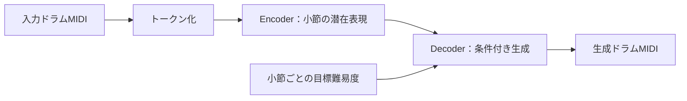

# Drum MuseMorphose：演奏難易度を調整するドラム譜生成

**元のリズムの特徴を保ちながら、演奏者に合わせて難易度を調整するドラム自動編曲**を目指す研究です。
ピアノ向け音楽生成モデル MuseMorphose をドラムに拡張し、入力MIDIから「手の連打を減らす」「足の負荷を下げる」といった条件に沿う譜面を生成します。

## 手法

Transformer VAE（変分オートエンコーダ）で入力譜面を小節ごとの潜在表現に変換し、指定した難易度を条件にトークン列を生成してMIDIへ戻します。



ドラムの表現には、小節・拍・打点位置・テンポと、楽器・奏法・強弱のトークンを使います。
難易度は次の5属性をそれぞれ8クラス（0〜7）に分けて指定します。

| 属性 | 表す内容 |
|---|---|
| 技術 `s_tech` | 特殊奏法の頻度 |
| 独立性 `s_indep` | 手足が異なるタイミングで動く割合 |
| 手 `s_hand` | 手の最大打撃密度 |
| 足 `s_foot` | 足の最大打撃密度 |
| 移動 `s_move` | 打点間の移動速度 |

難易度は譜面から算出する指標です。指定どおりの生成や、実際の演奏のしやすさを保証するものではありません。

## 基盤モデルからの差分（本研究で実装した部分）

比較元は [MuseMorphoseの元実装（`0695702`）](https://github.com/YatingMusic/MuseMorphose/tree/069570279db65ffb3914ca9aacab8061badfacb3) です。
**Transformer VAE、小節単位の潜在表現、`in-attn` / `pre-attn` 条件付けは元実装から継承**しています。
その上に、ドラムの演奏難易度を扱うため、以下の機能を追加・改良しました。

| 項目 | 元のMuseMorphose | 本研究で追加・改良した実装 |
|---|---|---|
| 譜面表現・前処理 | ピアノのREMIトークン列 | 楽器・奏法・強弱を表すドラム用standard、ドラム向けREMI、四肢ベースCPを実装。MIDI変換・語彙作成・データローダーを整備（[トークナイザー](src/tokenizers/)） |
| 難易度条件 | リズム密度・同時発音数の2属性 | 演奏難易度5属性の算出・8クラス化・小節ラベル付与と、各属性の埋め込みによる条件付き生成を実装（[難易度計算](src/data/drum_difficulty_calculator.py)、[モデル](src/models/musemorphose.py)） |
| Attentionバイアス | 通常のSelf-Attention | 同じ手足のグループを扱うLimb-Relation Biasと、同時打点を扱うPosition-Same-Time Biasを追加。適用する層も設定可能（[四肢](src/models/limb_bias.py)、[位置](src/models/position_bias.py)、[層別設定](src/models/bias_schedule.py)） |
| 生成機能 | テスト曲を抽出し、2属性をシフトして生成 | 任意の入力MIDI、難易度の一括増減・上限・小節別指定に対応。複数モデルの次トークン確率を平均するアンサンブル推論も追加（[入力MIDI生成](scripts/generate/generate_drum_from_input.py)、[アンサンブル](scripts/generate/generate_drum_ensemble.py)） |

これらは追加実装の範囲を示すもので、各機能の効果は設定ごとの比較実験で評価します。

## 評価と基準設定

評価では、指定難易度と生成譜面の難易度の相関、他属性への影響、Groove Similarity、Token IoUを確認します。
基準設定は [drum_config_standard-lakh1-kl14.yaml](config/drum_config_standard-lakh1-kl14.yaml) です。
standard表現と5属性の条件付けを使い、Limb Bias・Position Bias・階層位置埋め込みは無効です。

## 実行方法

リポジトリ直下で実行します。以下の複数行コマンドはBash形式です。
Python環境にドラム用の依存を導入し、CUDAを使う場合は環境に適合するPyTorchを用意してください。

```bash
python -m pip install -r requirements_drum.txt
```

**データ準備**：MIDIのトークン化 → 難易度境界の計算 → 小節ラベルの付与を行い、基準YAMLのデータ・語彙パスに配置します。
処理例は [tasks/data_creator.sh](tasks/data_creator.sh) にあります。既定では拡張データ用の `standard-lakhaug` に出力するため、入力・出力先を使用する設定に合わせてください。

**学習**：基準設定を明示して実行します。

```bash
python -m scripts.train.train_drum --config config/drum_config_standard-lakh1-kl14.yaml
```

**生成**：学習済み重み、その実験の `config.yaml`、語彙、難易度境界ファイルが必要です。
このブランチの生成CLIは境界を `data/metadata/difficulty_bounds_standard.pkl` から読むため、学習時と同じ境界ファイルをその場所に用意してください。

```bash
# 技術・独立性・手・足・移動の順に指定。手を1クラス下げる目標の例
python -m scripts.generate.generate_drum_from_input \
    --model_path trained_model/checkpoints_drum_standard-lakh1-kl14/params/best_params.pt \
    --input_midi input.mid --output_midi output/generated.mid \
    --difficulty_mode global_shift --difficulty_shift 0 0 -1 0 0
```

難易度は一括増減（`global_shift`）、上限指定（`upper_cap`）、小節ごとの指定（`full_assign`）に対応します。
引数の詳細は各CLIの `--help` で確認できます。

## コードと資料

| 場所 | 内容 |
|---|---|
| `src/models/` | VAE・Transformer・Attentionバイアス |
| `src/data/`・`src/tokenizers/` | データローダー・難易度計算・トークン化 |
| `scripts/` | 前処理・学習・生成・評価・解析のCLI |
| `config/`・`tasks/` | 実験設定と実行スクリプト |
| `tests/` | トークン変換・データ整合性・モデルの検証 |

詳細は [ドラム表現](docs/README_drum.md)、[難易度指標](docs/DIFFICULTY_README.md)、[四肢別Attention損失](docs/DESIGN_attn_bias_loss.md)、[位置別Attention損失](docs/DESIGN_attn_pos_bias_loss.md) を参照してください。
資料には旧パスの実行例も含まれるため、実行時は `python -m scripts...` と各CLIの `--help` を使用してください。

## 元実装と引用

本研究は Shih-Lun Wu、Yi-Hsuan Yang による MuseMorphose の実装を基にしたドラム拡張です。
ライセンスは [LICENSE](LICENSE) を参照してください。

```bibtex
@article{wu2023musemorphose,
    title={{MuseMorphose}: Full-Song and Fine-Grained Piano Music Style Transfer with One {Transformer VAE}},
    author={Shih-Lun Wu and Yi-Hsuan Yang},
    year={2023},
    journal={IEEE/ACM Transactions on Audio, Speech, and Language Processing},
}
```
